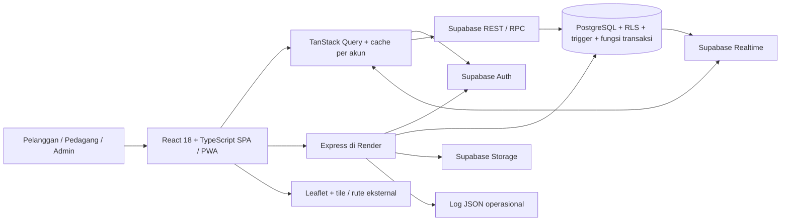

# Arsitektur Sistem Kelilingku

Versi implementasi 17 Oktober 2026. Gunakan dokumen ini untuk menjelaskan sistem
yang benar-benar ada, bukan menyebutnya Next.js, Android native, atau pembayaran
otomatis. Status penerapan terbaru harus dicocokkan dengan commit/deployment.

## Komponen



- Vite membangun frontend statis yang dihosting di Vercel. React Router menangani rute; bukan server-rendering Next.js.
- Supabase menyediakan autentikasi, API data, PostgreSQL, Realtime dan Storage. Browser memakai publishable/anon key serta sesi pengguna; RLS tetap wajib.
- Aturan transaksi kritis berada pada fungsi/trigger PostgreSQL, bukan sekadar tombol React. Ini menjaga reservasi dan penyelesaian stok atomik.
- Express memeriksa sesi melalui Auth untuk upload, operasi presence dan diagnostik. Service-role key hanya berada di environment backend.
- Leaflet menggambar peta. Penyedia tile/rute dan GPS perangkat adalah dependensi eksternal yang bisa gagal; status/fallback harus ditampilkan jujur.
- PWA menyediakan instalasi dan fallback offline. Tidak menjamin lokasi terus berjalan saat OS menangguhkan browser.

## Alur Pickup

```mermaid
sequenceDiagram
  actor C as Pelanggan
  participant UI as Frontend
  participant DB as Supabase / PostgreSQL
  actor V as Pedagang
  C->>UI: Pilih toko, produk, pengambilan dan pembayaran
  UI->>DB: create_pickup_order (sesi pelanggan)
  DB->>DB: Validasi pemilik/produk, harga server, reservasi stok
  DB-->>UI: Order pending dan ID terkonfirmasi
  DB-->>V: Notifikasi / perubahan realtime
  V->>DB: pending menjadi accepted
  V->>DB: accepted menjadi ready
  Note over C,V: Koordinasi lewat chat; kurir diatur pelanggan
  V->>DB: complete_pickup_order setelah barang diserahkan
  DB->>DB: COD lunas dan settlement stok tepat sekali
  DB-->>UI: completed dan status pembayaran
```

Untuk non-COD, pedagang memverifikasi pembayaran manual sebelum penyelesaian.
Tidak ada verifikasi otomatis dari bank/QRIS. Tidak ada form PIN pengambilan.
Order legacy tetap dapat dibaca dengan status lama, tanpa mengubah histori
menjadi pickup baru secara diam-diam.

## Pemuatan Dan Keandalan

Pesanan aktif dan riwayat memakai query berbeda. Satu halaman menampilkan 20
order, dengan satu baris lookahead dan join item/ulasan hanya untuk halaman itu.
Riwayat tidak diambil ketika tertutup. Filter pemilik/status dan pencarian
dilakukan di server, lalu cursor `(created_at,id)` menentukan halaman berikutnya.

Chat mula-mula mengambil 40 pesan paling baru. Pesan lama dimuat ketika diminta.
Realtime menambahkan pesan ke cache berdasarkan ID; pembacaan HTTP terpisah
mengejar pesan yang terlewat tanpa menjadikan pesan realtime terbaru sebagai
cursor kemajuan. Urutan memakai timestamp asli, termasuk presisi submilidetik.

Query dapat disegarkan ketika fokus/koneksi pulih. Data yang sudah ada tidak
dihapus saat refresh gagal. Mutasi tidak diulang atau diantrekan otomatis untuk
reconnect. Timeout adalah batas menunggu browser, bukan rollback transaksi
server; periksa order jika hasil penulisan belum pasti.

Satu instance Leaflet dipertahankan saat polling. Marker offline/kedaluwarsa
disembunyikan. Heatmap Area Pesanan adalah ringkasan koordinat order toko sendiri,
bukan klaim permintaan seluruh wilayah secara live.

## Keamanan Dan Bukti

Role aplikasi berasal dari profil yang dikonfirmasi database. Pelanggan hanya
mengakses order sendiri; pedagang hanya mengelola toko/order tokonya. Akses admin
harus diberikan resmi. Cache privat dibersihkan saat logout/pergantian akun,
bukan disimpan sebagai data transaksi offline.

Diagnostik tidak mengirim error mentah, isi chat, token, email atau koordinat.
Endpoint terautentikasi menerima kategori/area/source serta event UUID. Backend
menghasilkan `requestId` dan log JSON yang terbatas; log ini bukan pengganti tabel
transaksi atau jaminan seluruh gangguan tercatat.

Lihat [ERD dan tabel aktual](supabase-data-model.md),
[status verifikasi](performance-reliability.md), dan
[UAT fisik yang masih harus dibuktikan](uat-perangkat.md).
