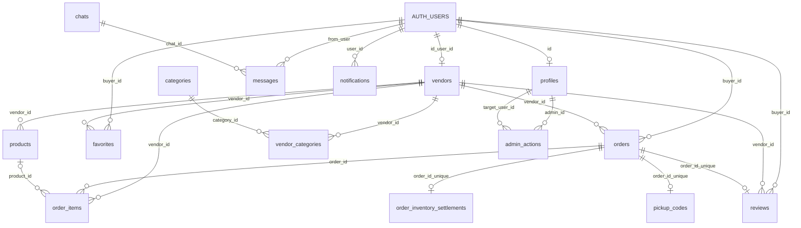

# Model Data Yang Diimplementasikan

Diperbarui 17 Oktober 2026 berdasarkan delapan skrip migrasi di repositori dan
`src/types/database.types.ts`. Ini dokumentasi skema yang sudah didefinisikan,
bukan rancangan tabel tambahan atau hasil introspeksi baru database hosted.

## Sumber Kebenaran

Urutan instalasi: `schema.sql`, `phase1-foundation.sql`, `admin-foundation.sql`,
`production-hardening.sql`, `order-payment-guard.sql`, `pickup-flow.sql`,
`pickup-simple-handover.sql`, `pickup-cod-progress.sql`.

Jangan menjalankan ulang migrasi hanya karena dokumentasi diperbarui.
`pickup-verification.sql` adalah pemeriksaan read-only.

## Tabel Aktual

| Tabel public | Fungsi dan kolom penting |
| --- | --- |
| `profiles` | Identitas aplikasi, `id`, `display_name`, `avatar_url`, `role`, `account_status`. ID mengacu ke `auth.users`. |
| `vendors` | Profil toko, `id`, `user_id`, `name`, `description`, `category_primary`, `online`, `is_verified`, `location`, `last_seen_at`, `mobility_type`, informasi operasional dan `payment_details`. |
| `products` | Katalog dengan `vendor_id`, `name`, `price`, `stock`, `reserved_stock`, `is_available`, `image_url`, `category_name`. |
| `categories` | Referensi kategori, bukan kode role. |
| `vendor_categories` | Relasi kategori ke toko melalui `vendor_id` dan `category_id`. UI juga memakai kategori utama toko/produk. |
| `orders` | Header transaksi, `vendor_id`, `buyer_id`, snapshot nama, `items`, `service_flow`, status, metode/status pembayaran, lokasi/titik pengambilan, total dan timestamp progres. |
| `order_items` | Snapshot nama/harga, `quantity`, `item_note`, `line_total`, `order_id`, `vendor_id`, dan `product_id` nullable. |
| `order_inventory_settlements` | Satu settlement per order, melindungi stok dari penyelesaian/pelepasan berulang. |
| `pickup_codes` | Sisa kompatibilitas versi awal pickup. Bukan form PIN atau kebutuhan UI saat ini; akses tidak boleh dibuka kembali. |
| `chats` | Percakapan dengan array UUID `participants`, kolom normalisasi `participants_normalized`, dan `last_updated`. |
| `messages` | Pesan dengan `chat_id`, `from_user`, `text`, `created_at`. Foto/caption memakai payload terstruktur dalam teks; berkas berada di Storage. |
| `notifications` | Event untuk pemilik `user_id`, `type`, `entity_type`, `entity_id`, `is_read`, `read_at`. |
| `reviews` | Satu ulasan per `order_id`, pemilik `buyer_id`, toko `vendor_id`, `rating`, `comment`. |
| `favorites` | Pasangan `buyer_id` dan `vendor_id`. |
| `admin_actions` | Catatan moderasi melalui `admin_id`, `target_user_id`, jenis aksi dan konteks audit sesuai SQL. |

Tidak ada tabel terpisah `payments`, `meeting_points`, `reports`, atau
`vendor_verifications` pada kontrak ini. Pembayaran/titik pengambilan berada di
`orders`; verifikasi berada di `vendors`. Jangan menjelaskan tabel rencana lama
seolah sudah diimplementasikan.

## ERD Ringkas

`AUTH_USERS` pada diagram adalah alias visual untuk tabel asli `auth.users`.
Garis di bawah mewakili FK yang ada di SQL; diagram memilih relasi inti agar
mudah dibaca, bukan menggantikan daftar constraint lengkap.

`chats.participants` adalah array, bukan tabel penghubung atau FK ke profiles.
Keanggotaan dijaga policy/trigger. Relasi profil pelanggan ke order menggunakan
identitas `auth.users`, bukan FK `orders.buyer_id -> profiles.id` yang tidak ada.

## Aturan Transaksi

- Pesanan baru `service_flow=pickup_v1`: `pending -> accepted -> ready -> completed`, atau `cancelled`/`rejected`.
- Metode pengambilan `self_pickup` atau `customer_courier`. Tidak meminta jadwal, koordinat kurir, atau PIN baru di UI.
- `create_pickup_order` memvalidasi produk, mengambil harga server, membuat header/item dan reservasi stok dalam satu transaksi.
- `complete_pickup_order(target_order_id)` menyelesaikan progres utama. COD lunas dan stok diselesaikan atomik; retry tidak boleh memotong stok dua kali.
- Transfer/QRIS/e-wallet adalah konfirmasi manual. Informasi pembayaran toko disnapshot; bukan payment gateway otomatis.
- Produk dengan `stock=null` memakai stok opsional; `is_available=false` tetap menandai habis.
- Status `preparing`, `on_the_way`, `arrived` serta kolom jadwal lama dipertahankan untuk transaksi legacy, bukan alur pickup baru.
- Chat membantu koordinasi, bukan sumber kebenaran harga, item atau pembayaran.

## Keamanan Dan Privasi

Pelanggan membaca order sendiri, pedagang membaca order tokonya. Mutasi mengikuti
guard/RPC dan akun aktif; tidak cukup mengandalkan tombol frontend. Admin memakai
akun resmi dengan `profiles.role=admin` dan policy/`is_admin()` yang berlaku,
bukan service-role key dalam browser.

Marker publik membutuhkan pedagang online, terverifikasi, lokasi valid dan
`last_seen_at` maksimal 120 detik. Offline menyembunyikan lokasi. Posisi pelanggan
untuk pencarian berada di browser; titik yang disertakan pada order memang
tersimpan di order untuk transaksi. Jangan menjanjikan bahwa seluruh koordinat
pelanggan tidak pernah disimpan.

Area Pesanan memetakan riwayat order milik toko yang memiliki koordinat, bukan
seluruh permintaan pasar. Kurir mandiri tanpa koordinat tidak diberi pin buatan.

## Pembacaan Efisien

Daftar pesanan memakai halaman 20 baris dengan lookahead satu baris, join
`order_items` dan `reviews`, filter status serta identitas pemilik di server.
Riwayat dimuat ketika dibuka. Cursor `(created_at,id)` menjaga timestamp sama
tidak membuat baris hilang. Pencarian memakai snapshot produk di `orders.items`,
nama kedua pihak, catatan order dan patokan; bukan pencarian catatan tiap item.

Chat membuka 40 pesan terbaru lalu memuat pesan lama sesuai permintaan. Cursor
HTTP untuk mengejar pesan terlewat dipisahkan dari event realtime baru. Tidak
menambahkan tabel/migrasi/index fiktif untuk perubahan pagination ini.

Lihat [arsitektur](architecture-refactor.md),
[performa dan keandalan](performance-reliability.md), dan
[UAT perangkat](uat-perangkat.md).
